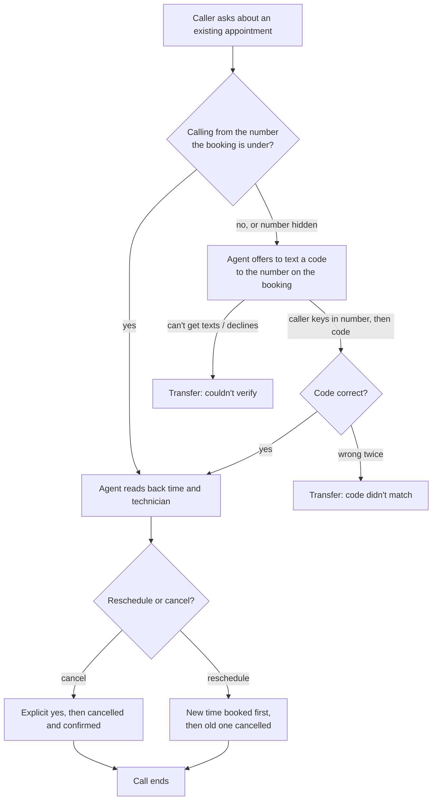

# Journey: an existing appointment (check, reschedule, cancel)

**For:** service operations, compliance. **Covers:** the `candidate` agent
version, which adds text-code verification and the consent question.
**Owner:** the AI experience engineer, who changes the journey once ops
signs off.

## What the customer can get done without a person

- Hear when their appointment is and who it's with.
- Move it to another open time.
- Cancel it.

Everything else in this journey goes to the on-call service advisor.

## How the call goes

## Every way this journey ends

| Situation | What the caller hears or gets | Person needed? |
|---|---|---|
| Verified, cancels | Cancellation confirmed on the call | No |
| Verified, reschedules | New time and technician read back. The new booking is made **before** the old one is cancelled, so a failure never leaves them with nothing | No |
| Verified, no appointment found | Told so, and offered a new booking | No |
| Wrong phone, code correct | The same as verified. The booking stays under the original number | No |
| Wrong code twice | "That code didn't match, so I can't make changes to this appointment - connecting you to our on-call service advisor now." | Yes |
| Can't receive or doesn't want a text | "I'm not able to verify this call to make changes to an existing appointment - connecting you to our on-call service advisor now." | Yes |
| Booking system is down | Told someone will call back. Nothing is confirmed that didn't happen | Callback |
| Caller can't be understood twice | Transfer | Yes |

## What the agent will never do

- **Change an appointment for an unverified caller.** A name, or a number
  the caller says, doesn't count. Only the caller's real calling number or
  a correct texted code counts. The system checks that the appointment
  belongs to that number even if the agent is talked into trying.
- **Take a phone number or code by voice.** Both are keyed in on the
  keypad, because speech recognition has misheard digits on a real call.
- **Say whether a number has an appointment** before the caller has proven
  they hold that phone.
- **Send a text the caller said no to.** Every booking, including the new
  half of a reschedule, asks before texting a confirmation.
- **Make up a time, price, or promise.** Times are read from the system
  exactly as written. The agent says it has no pricing.

## Wording that is fixed

These lines are spoken by the system word for word. The agent can't
change them. Changing one is a code change and goes through the same
testing as any other change.

- Opening: "Thanks for calling the after-hours service department. You're
  speaking with an automated assistant, and this call may be recorded.
  What's going on with your vehicle?"
- Both transfer lines in the table above.
- Every text ends with "Reply STOP to opt out."

## What the advisor gets on a transfer

The reason for the transfer, and whether the caller was verified and how
(calling number or texted code). The system records these, not the agent.
Also every step the agent tried and its result, plus a one- or
two-sentence summary that the agent writes and that is labelled as such.

## How we know it's working

Reported weekly (`weekly_review.py`) for the "existing appointment"
journey:

- **Containment:** the share of calls that end without a person. This is
  measured twice, by what the system recorded and by an independent AI
  review of each call.
- **Fix list:** every transferred or flagged call with the reviewer's
  reason. Any call where the opening line wasn't word for word goes at the
  top.
- **Per version:** the old and new agent are compared during a rollout.

## Changing this journey

| You want to... | Who | How it ships |
|---|---|---|
| Change what the agent says in its own words | Ops proposes, engineering edits | Tested in simulation, then rolled out to 1% → 100% of calls |
| Change fixed wording (opening, transfer lines, texts) | Compliance approves the exact text | Code change, same testing |
| Change a limit (two codes, two wrong tries) | Ops and compliance | Code change |
| Add a new thing customers can do (e.g. pay an invoice) | Product and ops scope it | New journey, see [ADR-0004](../adr/0004-card-payments-leave-the-media-stream.md) for payments |
